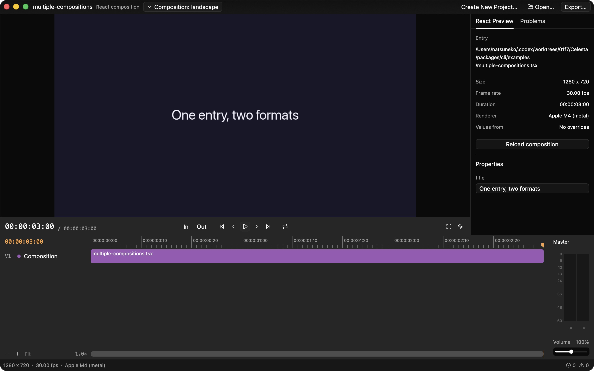
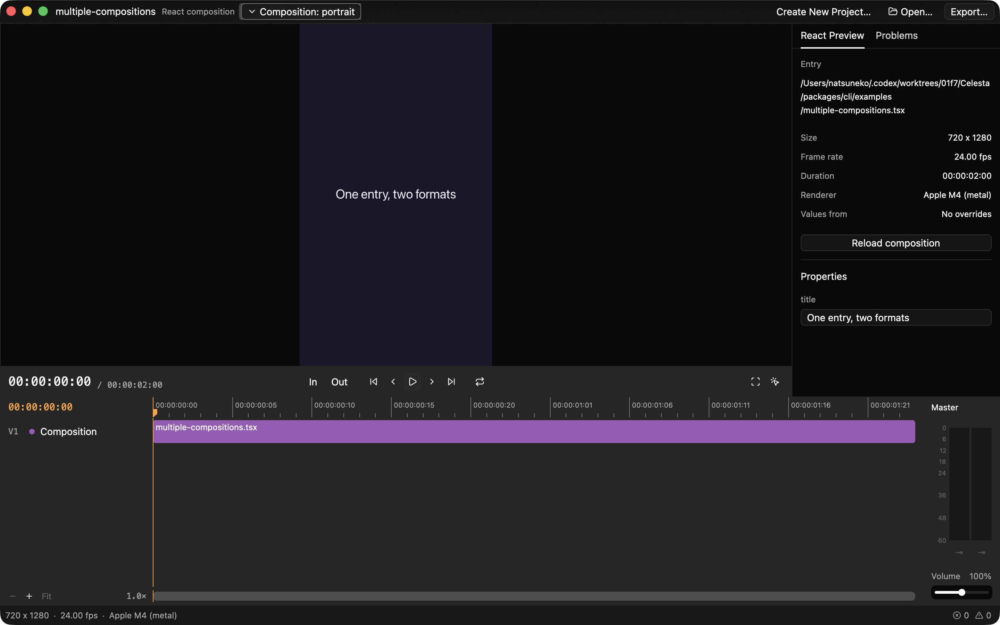

# Issue #304: multiple compositions

An entry can return a fragment of root `Composition` elements. Each root needs
its own non-empty, unique `id` when there is more than one. The first root is
the default selection; a single unnamed root has the ID `default`. An unknown
ID fails with the available IDs. The entry shares its property schema, values,
and `prepare()` data, while inactive composition children remain unmounted.

The editor's title-bar menu and `--composition ID` select the root. Preview,
audio, and export use the same selection. Exporter `--json`, native inspection,
`inspect.mjs`, and MCP return `compositionId` and `compositions` (inside `ready`
for inspection protocols). The list includes dimensions, frame rate and duration
in frames for every root.

## Rendering comparison

Both captures use `packages/cli/examples/title.tsx`, frame 45 at 30 fps,
1920 × 1080, on the same native exporter and machine. **Before** uses the React
runtime source from commit `607cad8`; **after** uses this change. The decoded
RGBA pixels are identical. The native renderer is unchanged.

| Before | After |
| --- | --- |
|  |  |

## Native editor check

Opened `packages/cli/examples/multiple-compositions.tsx`, selected `portrait`
through the composition menu using the keyboard, checked 720 × 1280, 24 fps,
and two seconds, then switched back to `landscape` and checked 1280 × 720,
30 fps and three seconds. Escape dismisses the menu; the trigger shows the
active ID. Entry-wide properties remain visible across the switch.

| Landscape | Portrait |
| --- | --- |
|  |  |

## Automated verification

- Runtime build and all 89 CLI tests passed, including ID validation,
  default selection, selected clock/size/audio, inactive roots, shared props,
  and `inspect.mjs` JSON.
- 397 Rust unit and integration tests passed across the editor, exporter,
  React bridge and MCP. The new native integration test verifies both PNG
  dimensions, JSON lists, default selection and unknown-ID errors.
- Code generation passed (113 tests); exporter and React bridge doc tests passed.
- `cargo check` passed for the editor and MCP with all targets.
- Full Clippy with warnings denied hits existing lints in `celesta-budoux`
  (`needless_range_loop`) and existing constant `chunks_exact` calls. The
  targeted change check excludes dependency lints and permits only
  `clippy::chunks_exact_to_as_chunks` for the pre-existing calls.

On macOS, native checks use
`PKG_CONFIG_PATH=/opt/homebrew/opt/ffmpeg@8/lib/pkgconfig` as described in the
packaging instructions.
