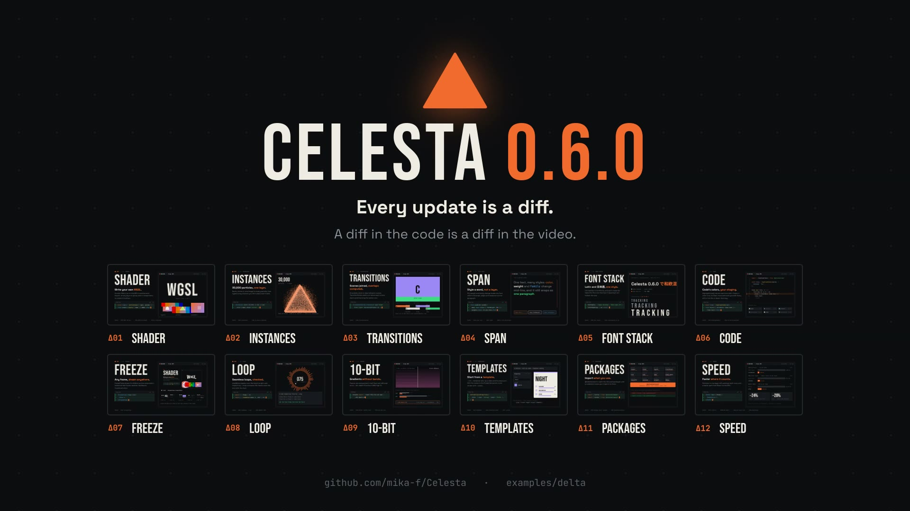

# DELTA

Celesta のリリースごとに「前のバージョンから何が変わったか」をまとめるモーショングラフィックのシリーズです。
インク黒とオレンジ、Bebas Neue の見出し、Space Grotesk の本文、JetBrains Mono のコードで、
各機能をリリースノートの 1 ページのように見せます。見出し、何ができるか、それを使う差分、マージされた PR、そしてその場で動くデモです。

- `film-0.6.0.tsx` — v0.5.0 → v0.6.0 の 62 秒（エントリ）。Celesta の File → Open… で開きます。
- `components/` — シリーズ共通の見た目。配色・書体・テンポ（`theme.ts`）、章のページ（`ChapterShell.tsx`）、右上の進行表示（`Hud.tsx`）、差分パネル（`DiffPanel.tsx`）、WGSL シェーダー（`shaders.ts`）、背景のドット（`Backdrop.tsx`）、Δ マーク（`Delta.tsx`）。
- `v0.6.0/` — このリリースの中身。冒頭（`Open.tsx`）、12 章の一覧（`chapters.tsx`）とデモ（`demos/`）、アウトロ（`Outro.tsx`）、リリースノートの PR 一覧（`prs.ts`）、章の位置（`timeline.ts`）。
- `make-score-0.6.0.py` — BGM を生成する Python スクリプト。標準ライブラリのみ。
- `poster.jpg` — 書き出した映像のアウトロから抽出した静止画。

次のリリースは `film-<version>.tsx` と `v<version>/` を足し、`components/` を使い回します。



## 構成（v0.6.0）

1920×1080、30 fps、120 BPM（1 拍 = 15 フレーム、1 小節 = 60 フレーム）。章は 2 小節ずつで、切り替えは小節の頭に落ちます。

| 時間 | 内容 |
| --- | --- |
| 0–2 秒 | v0.6.0 のリリースノートに載った 60 本の PR が流れ、右の番号が #168 から #273 まで進む |
| 2–4 秒 | ログが 7,000 個の粒子にほどけ、Δ に集まる |
| 4–6 秒 | Δ が画面を覆うオレンジに膨らみ、DELTA がグリッチしながら定まる |
| 6–10 秒 | Δ01 SHADER — 自作 WGSL の ripple / glitch / pixelate がその場で動く |
| 10–14 秒 | Δ02 INSTANCES — 30,000 粒子の円盤が Δ の輪郭に折りたたまれる |
| 14–18 秒 | Δ03 TRANSITIONS — 本物の `TransitionSeries` の縮小再生と、`computeTransitionSeries()` のタイムライン |
| 18–22 秒 | Δ04 SPAN — 1 つの Text の中で語ごとに色・太さ・書体が変わり、折り返し幅が動いても 1 段落のまま |
| 22–26 秒 | Δ05 FONT STACK — 欧文と和文を 1 つのスタックで組み、`letterSpacing: { em }` を 3 サイズで比べる |
| 26–30 秒 | Δ06 CODE — `highlightCode()` の行が 1 行ずつ入り、行の color run を一覧する |
| 30–34 秒 | Δ07 FREEZE — この映像そのものを Δ01 まで巻き戻して再生し、過去の 5 場面を並べる |
| 34–38 秒 | Δ08 LOOP — `loopNoise` で動く 120 フレームのリングと `inspect.mjs --loop` の結果 |
| 38–42 秒 | Δ09 10-BIT — 暗いグラデーションのバンディングとディザ、#252 の計測値、`--bit-depth 10` |
| 42–46 秒 | Δ10 TEMPLATES — `--init --template`、Properties パネル、`--props` で同じテンプレートの値を差し替える |
| 46–50 秒 | Δ11 PACKAGES — `@celesta/react` から 12 のパッケージが立ち上がり、codemod が import を移す |
| 50–54 秒 | Δ12 SPEED — 各 PR の before / after |
| 54–62 秒 | Δ、タグライン、12 章のサムネイル。最後の和音が鳴り切って終わる |

## 新機能で作っている部分

紹介している機能の多くは、この映像自体の組み立てにも使っています。

- 章の切り替えは 1 つの `TransitionSeries`（`wipe`）。章の頭は `computeTransitionSeries()` の結果から求め、`timeline.ts` と一致するかを読み込み時に確かめます。
- 背景のドットは `<Static>` の中の `<Instances>`、冒頭の粒子と INSTANCES 章も `<Instances>` です。
- 差分パネルは `highlightCode()` の行と color run を自前で描いています。
- 章タイトルは `useFitText()` で幅に合わせ、`letterSpacing: { em }` で字間を詰めながら入ります。
- 見出しの強調は `<Span>`、和文を含む文字はすべて `fontFamily` のスタック（`[欧文, 'Noto Sans JP']`）で組んでいます。
- DELTA カードのグリッチ、SHADER 章の 3 種は `defineShader` の WGSL です。
- FREEZE 章とアウトロのサムネイルは、この映像そのものを `<FreezeFrame>` で描き直したものです。
- 使っている API はすべて v0.6.0 で公開されているものです（色フィルタや `shader` の配列など、その後に入ったものは使っていません）。

## 本物と演出

- **実際の機能**: 上に挙げたもののほか、SHADER のシェーダー、TRANSITIONS の再生とタイムライン、SPAN の再折り返し、
  FONT STACK の和欧混植と em 指定の字間、CODE の行と run、FREEZE の巻き戻し、LOOP のリングの周期性はすべて実際の描画です。
- **説明のための描画**: 10-BIT の左半分のバンディングは段差を手で描いた図解で、右半分が実際のグラデーションです。
  TEMPLATES の Properties パネルとランキングのカードはアプリ画面やテンプレートの出力ではなく、似せて描いたものです。
  LOOP と TEMPLATES と PACKAGES の端末表示は、v0.6.0 のコマンドと `inspect.mjs --loop` の出力形式に合わせた文面です。
- **数値**: SPEED と 10-BIT の数値は各 PR に書かれた計測値です（いずれも同じマシンでの before / after。
  #259・#272・#180・#266 は Apple M4、#189 は Windows）。計測の対象が違うため、棒は組ごとに別の尺度です。

## 再生成

WAV と MP4 はリポジトリ全体の設定で Git の管理対象外です。クローン後は最初にスコアを生成してください。

```sh
python3 examples/delta/make-score-0.6.0.py
node skills/celesta/scripts/inspect.mjs examples/delta/film-0.6.0.tsx --frames 0,900,1859
Celesta-export --json --react examples/delta/film-0.6.0.tsx examples/delta/delta-0.6.0.mp4
```

ソースから実行する場合は `Celesta-export` を `cargo run -p celesta-exporter --release --` に置き換えます。
フォントは初回に Google Fonts から取得され、以降はキャッシュされます。
