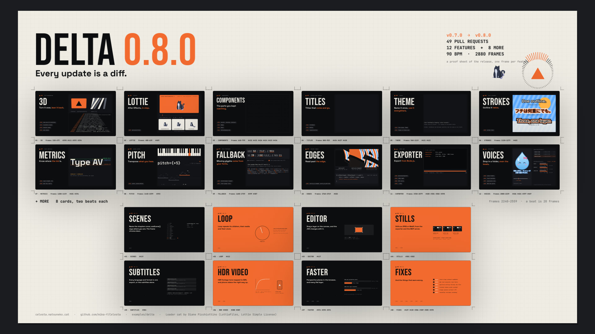

# DELTA

Celesta のリリースごとに「前のバージョンから何が変わったか」をまとめるモーショングラフィックのシリーズです。
インク黒とオレンジ、Bebas Neue の見出し、Space Grotesk の本文、JetBrains Mono のコードで、
各機能をリリースノートの 1 ページのように見せます。見出し、何ができるか、それを使う差分、マージされた PR、そしてその場で動くデモです。

- `film-0.8.0.tsx` — v0.7.0 → v0.8.0 の 96 秒「PROOF」（エントリ）。Celesta の File → Open… で開きます。
- `shorts-0.8.0.tsx` — 同じ 96 秒を 1080×1920 の窓で見たショート版（エントリ）。
- `film-0.7.0.tsx`・`shorts-0.7.0.tsx` — v0.6.0 → v0.7.0 の 91 秒と、そのショート版。
- `film-0.6.0.tsx` — v0.5.0 → v0.6.0 の 62 秒。
- `components/` — シリーズ共通の見た目。配色・書体（`theme.ts`）、章のページ（`ChapterShell.tsx`）、右上の進行表示（`Hud.tsx`）、差分パネル（`DiffPanel.tsx`）、WGSL シェーダー（`shaders.ts`）、背景のドット（`Backdrop.tsx`）、Δ マーク（`Delta.tsx`）。0.7.0 は BGM のメーター付きの `Hud.tsx` を `v0.7.0/` に持ちます。
- `v0.8.0/`・`v0.7.0/`・`v0.6.0/` — 各リリースの中身。冒頭（`Open.tsx`）、章の一覧（`chapters.tsx`）とデモ（`demos/`）、アウトロ（`Outro.tsx`）、リリースノートの PR 一覧（`prs.ts`）、テンポと章の位置（`timeline.ts`）。
  0.7.0 以降は 2 つのエントリが同じカット（`reel.tsx`）を、それぞれのキャンバスに組んで再生します。
  0.8.0 は章をページとして切り替える代わりに、1 枚の紙（`sheet.ts`・`tiles.tsx`）をカメラが読む構成で、冒頭は `open.tsx` です。
- `make-score-<version>.py` — BGM を生成する Python スクリプト。標準ライブラリのみ。
- `poster-0.8.0.jpg`・`poster-0.7.0.jpg`・`poster.jpg` — 0.8.0 と 0.7.0 は `poster` コンポジションの書き出し（0.8.0 は JPEG で直接）、0.6.0 は映像のアウトロから抽出した静止画。

次のリリースは `film-<version>.tsx` と `v<version>/` を足し、`components/` を使い回します。
`components/` は v0.6.0 の API だけで書かれており、0.6.0 の映像はそのまま v0.6.0 で動きます。



## 構成（v0.8.0）

0.7.0 までのように章ごとのページをトランジションで切り替えるのではなく、12 の機能と MORE の 8 枚を 1 枚の紙（校正刷り）に刷り、
カメラがその紙をタイルからタイルへ読んでいく構成です。紙の地にインクのタイルで、タイルは 1920×1080 のフレーム。
着くと画面いっぱいになり、そのタイルのデモが動きます。

1920×1080、30 fps、90 BPM のローファイ（1 拍 = 20 フレーム、1 小節 = 80 フレーム）。冒頭 4 小節、12 の機能が 2 小節ずつ、
MORE が 2 拍ずつ 8 枚、締め 4 小節で 96 秒です。デモの中の BEAT / BAR は 8 分音符（10 フレーム）と 2 拍（40 フレーム）です。

| 時間 | 内容 |
| --- | --- |
| 0–2.7 秒 | 表紙。v0.8.0 までにマージされた 49 本の PR が `rotationX` と `perspective` で奥へ倒した面を流れる |
| 2.7–5.3 秒 | 2 小節目の頭で「0.8.0」の判が押される（3 本の `stroke` のリストで 3 重のフチ）。表紙が上端を軸にめくれて飛ぶ |
| 5.3–10.7 秒 | 傾けた紙の見出しから、タイルの並びの上を回り込みながら、最初のタイルへ降りる |
| 10.7–74.7 秒 | Δ01 3D・Δ02 LOTTIE・Δ03 COMPONENTS・Δ04 TITLES・Δ05 THEME・Δ06 STROKES・Δ07 METRICS・Δ08 PITCH・Δ09 FALLBACK・Δ10 EDGES・Δ11 EXPORTER・Δ12 VOICES。各 5.3 秒、最後の 1.2 秒で次のタイルへ跳ぶ |
| 74.7–85.3 秒 | MORE — SCENES / LOOP / EDITOR / STILLS / SUBTITLES / HDR VIDEO / FASTER / FIXES を 2 拍ずつ |
| 85.3–96 秒 | 紙から離れて傾き、最後は紙全体が 16:9 に収まって止まる（これがポスター）。見出し・BGM のスペクトルの輪・Loader cat |

タイルの左には章の名前・見出し・マージされた PR（`Badge`）、右にはデモ（ステージを 1.2 倍）。紙の上のタイルの角にはトンボ、
下にはタイルの章名・フレーム番号・PR 番号を刷っています。カメラが来るまでのタイルは、その章の 1 フレームを `<FreezeFrame>` で止めた絵です。

BGM は D マイナー（Dm9 – B♭maj7 – Gm9 – A7）。スウィングするブーンバップのドラム、エレピ、サブベース、レコードのノイズで、
カメラが跳ぶたびにテープの風切り音が鳴ります。METRICS と PITCH は軽くし、PITCH では 2 拍ごとに和音を変えてリフ（`pitch-0.8.0.wav`）を乗せます。
FALLBACK からビブラフォンを足し、最後はテープが止まって終わります。

## 新機能で作っている部分（v0.8.0）

- カメラは、紙を画面の中央（`originX` / `originY`）を軸に `rotationX` と `rotation` で傾け、`perspective` をかけたものです（`v0.8.0/sheet.ts` の `shotAt()`）。
- タイルは `Panel`、紙は `PatternBackground`、PR は `Badge`。全体を DELTA の書体と色を名前にした `<Theme>`（`v0.8.0/theme.tsx`）で包み、`fill="ink"`・`color="orange"` のように名前で書いています。
- 四隅のタイトル・タイムコード・章名・進み具合は `FrameChrome` です。章の名前と長さは `defineScenes()` で宣言し（`v0.8.0/timeline.ts`）、`FrameChrome` が `useScene()` で読みます。
- コンポジションは `fontFallback="loaded"` で、和文は欧文の書体に足りない文字として、読み込んだ Noto Sans JP から描かれます。
  Noto Sans JP は `<Font google text>` で、この映像が描く和文だけを読み込みます（`v0.8.0/fonts.tsx`）。
- BGM の解析は `loadAudioSpectrum()` の上限を既定の `'auto'`（ファイルのいちばん大きいバンド）に任せています。
- PITCH 章のリフは 1 つの WAV を `<Audio pitch>` で移調して鳴らしています（`PitchRiff`）。
- VOICES 章は `prepare()` でリポジトリのボイスフォルダー（`examples/assets/voice-folder/shizuku`）を `importVoiceFolder()` で読み、`matchVoiceLevels()` で測ります。
- MORE の LOOP カードの針は `<Loop durationInFrames={20}>` の中にあり、1 拍ごとに時計が 0 に戻ります。
- `poster` コンポジションは `--quality 85` の JPEG として直接書き出しています。

## ショート版（v0.8.0）

`shorts-0.8.0.tsx` は同じ紙と同じカメラを 1080×1920 の窓で見たものです。タイルが窓の幅に合い、上下のタイルも見えたまま読み進めます。
冒頭の表紙は縦に組み直し、`<DebugOverlay safeArea="vertical-social" />` でセーフエリアの補助線を描きます（プレビューと `--debug-guides` 付きの PNG のみ）。

## 本物と演出（v0.8.0）

- **実際の機能**: 上に挙げたもののほか、3D のカードと床、LOTTIE の再生（速さ・向き・止める位置）、COMPONENTS・TITLES・THEME の部品と数値（PR の種類は PR のタイトルの接頭辞から数えたもの）、
  STROKES のフチ、METRICS の各値（カーニングは「A」単体と「AV」の中の送り幅の差）、PITCH の音、FALLBACK の書体の振り分けと文字数、EDGES のシェーダー、
  VOICES のファイル・長さ・表情のキュー・声量の測定値と補正量、MORE の SCENES の一覧（`useScene(SCENE_LIST, { clock: 'root' })` で読んだこの映像の章）、LOOP の針、SUBTITLES の字幕（この映像の字幕の 2 つ目）は実際の描画と計算です。
- **説明のための描画**: EXPORTER の端末と進み具合は描いたもので、イベント名とフィールドは `@celesta/exporter` のもの、フレーム数はこの映像のものです。
  静止画のサムネイルはこの映像の Δ01 のフレームです。EDITOR のキャンバスのハンドルと書き戻しは似せて描いたものです。
  HDR VIDEO のトーンカーブは形を示した図で、「203 nits → sRGB 188」は #388 に書かれた値です。VOICES の声は鳴らしていません（BGM が鳴っているため）。
- **数値**: FASTER は各 PR に書かれた計測値です（#394 は Chrome・Apple silicon の 1 フレームあたり、#390 は 100 万レイヤーあたり）。組ごとに別の尺度です。
- **Lottie**: 「Loader cat」は Diane Picchiottino の作品で、LottieFiles の Lottie Simple License で配布されています（`v0.8.0/assets/README.md`）。
  尻尾の影は 3D レイヤーのため `<Lottie>` では描かれず、書き出しのたびに警告が 1 回出ます。

## 構成（v0.7.0）

1920×1080、30 fps、180 BPM のドラムンベース（1 拍 = 10 フレーム、1 小節 = 40 フレーム）。
12 の章は 4 小節ずつ、続く MORE は 1 小節に 1 枚のカードが 8 枚です。切り替えはすべて小節の頭に落ちます。

| 時間 | 内容 |
| --- | --- |
| 0–2.7 秒 | 白い閃光のあと、v0.7.0 までにマージされた 47 本の PR が `<MotionBlur>` をかけて流れ、右の番号が #220 から #361 まで進む |
| 2.7–4 秒 | Δ が破線で描かれ、拍ごとに星・ハート・六角形へ `interpolatePath()` で形を変えながら `<Trail>` を引く |
| 4–5.3 秒 | 「0.7.0」の文字をマスクにして、これから出てくる章が 1 拍ずつ文字の中に映る |
| 5.3–8 秒 | オレンジの DELTA カード。WGSL のグリッチと組み込みの色収差・走査線を 1 つの `shader` 配列で重ね、最後の無音の拍で反転してズームブラーがかかる |
| 8–13.3 秒 | Δ01 TRANSITIONS — プレビューの中の本物の `TransitionSeries` が 2 拍ごとに新しい 7 種で切り替わる |
| 13.3–18.7 秒 | Δ02 MASK — MASK の文字の中で DELTA カードが再生され、ぼかした円の輝度マスクがスポットライトになり、最後に反転する |
| 18.7–24 秒 | Δ03 MOTION BLUR — 同じ車輪と Δ をブラーなしと `<MotionBlur>` で並べ、跳ねる星に `<Trail>` |
| 24–29.3 秒 | Δ04 EFFECTS — 同じ絵にハーフトーン・ピクセル化・色収差・波・ノイズ・走査線・ズームブラーを 2 拍ずつかけ、最後にクロマキー |
| 29.3–34.7 秒 | Δ05 COLOR — 色補正のプロパティ 8 種を並べ、続いて `shader` 配列を 1 段ずつ積む |
| 34.7–40 秒 | Δ06 BLEND — 17 のブレンドモードを同じ背景と円で並べる |
| 40–45.3 秒 | Δ07 SHAPES — Triangle・Polygon・Star・Pie・Heart の角が拍に合わせて丸まり、破線と点線が流れる |
| 45.3–50.7 秒 | Δ08 PATHS — SVG のパスを `progress` で描き、先端の矢印が接線に沿って進む。下では輪郭が拍ごとにモーフィングする |
| 50.7–56 秒 | Δ09 SPECTRUM — いま鳴っているこの映像の BGM の 32 バンドと音量、直近 3 秒のスペクトログラム |
| 56–61.3 秒 | Δ10 MEDIA — 音の鳴る `<Video>` とループ、時間に合わせて進むアニメーション画像、透過の書き出し |
| 61.3–66.7 秒 | Δ11 MCP — エージェントが `render_frames` でこの映像の 3 フレームを受け取り、`inspect` する |
| 66.7–72 秒 | Δ12 EDITOR — この映像のクリップと BGM の波形が並ぶタイムライン、ピンチでのズーム、ソースを開く、Problems タブ |
| 72–82.7 秒 | MORE — COMPOSITIONS / GOOGLE FONTS / SUBTITLES / SAFE AREAS / AIVISSPEECH / REACT 19 / WEBSITE / FIXES |
| 82.7–90.7 秒 | BGM のスペクトルが輪になって脈打つ Δ、タグライン、13 場面のサムネイル。最後の和音とベルが鳴り切って終わる |

BGM は 0.6.0 の 120 BPM のハウスから変え、映画予告風のブラスとサブベースで始まるドラムンベースにしました。
F マイナー（Fm – D♭ – B♭m – C）の 2 ステップにリースベースを乗せ、SHAPES と PATHS の 2 章だけ軽く落とし、
SPECTRUM からはリードを足して 2 回目のドロップにしています。MORE の後半はドラムを抜いてスネアのロールで盛り上げます。

## 新機能で作っている部分（v0.7.0）

- 章の切り替え 14 か所に同じものはありません。組み込みの 11 種すべて（0.7.0 で入った iris・clock-wipe・zoom・dissolve・blur・flip・cube を含み、iris と zoom は開く向きと閉じる向きの両方）と、
  `defineTransition()` で定義した 2 種（冒頭から Δ01 への Δ 形のマスク、SPECTRUM への色収差とピクセル化のグリッチ）です（`v0.7.0/cuts.tsx`）。
- 冒頭の PR ログは `<MotionBlur>`、モーフィングする Δ は `<Trail>`・`interpolatePath()`・破線の `<Path progress>`、
  「0.7.0」は `<Group mask>` で、文字の中の章は `<FreezeFrame>` です。
- DELTA カードと MORE のカードは、WGSL のシェーダーと組み込みの `chromaticAberration`・`scanlines`・`pixelate` を 1 つの `shader` 配列で重ねています。
- `prepare()` で BGM を `loadAudioSpectrum()` に通し、右上のメーター（`useAudioSpectrum()`）、冒頭の色収差、SPECTRUM 章、
  エディタ章の波形、アウトロの輪が同じ解析結果で動きます。
- 欧文の 3 書体は `<Font google="…">` で名前から読み込み、和文は使う文字だけの Noto Sans JP です。
- 各場面の字幕（日本語と英語）を言語ごとの `<Subtitles lang>` に渡しており、`--subtitles` で SRT または WebVTT として書き出せます（画面には描きません）。
  パスに `{lang}` を入れると、言語ごとに別のファイルになります。
- エントリには `film` と `poster` の 2 つのコンポジションがあります。`poster` はアウトロの 1 フレームを `<FreezeFrame>` で描いたものです。
- MCP 章のフレーム、エディタ章のプレビュー、MASK 章のカード、アウトロのサムネイルは、この映像そのものを `<FreezeFrame>` で描き直したものです。

## ショート版（v0.7.0）

`shorts-0.7.0.tsx` は本編と同じ 91 秒・同じ BGM・同じ切り替えを 1080×1920 で再生する縦長版です（Shorts、TikTok、Reels 向け）。

- **組み直した部分**: 冒頭・MORE・アウトロは、本編と同じ部品がキャンバスの大きさに合わせて組み直されます。
  章のページは縦用の `ShortChapter.tsx` で、ラベル・タイトル・見出し・差分を上に、デモ（本編の 860×742 のステージを 0.95 倍）を下に大きく置きます。
  本文の説明は省き、PR 番号はプレビューの見出しに移しています。
- **セーフエリア**: 読ませる文字は `'vertical-social'`（上 192・右 200・下 384・左 72 px）の内側に置いています。
  ただし、タイトルが入ってくるときの字間や、デモの枠の端は少しはみ出します。
  中央に置くもの（冒頭の図形や DELTA カード、アウトロ）は、セーフエリアではなく画面の中心に揃えています。
- **セーフエリアの外側**: プラットフォームの UI に隠れる縁は `ShortFrame.tsx` が埋めます。
  下端には BGM のバンドが帯になって伸び縮みし、右下には章番号が大きく画面からはみ出して置かれ、右端を章名が縦に流れます。
- **本編の再利用**: リプレイやサムネイル（冒頭のティザー、MASK、MCP、EDITOR、SUBTITLES、アウトロ）は横長の本編のフレームです。
- **補助線**: `<DebugOverlay safeArea="vertical-social" />` を入れてあり、アプリのプレビューと `--debug-guides` 付きの PNG にだけ描かれます（MP4 には描かれません）。

## 本物と演出（v0.7.0）

- **実際の機能**: 上に挙げたもののほか、TRANSITIONS の再生、MASK の文字マスクと輝度マスク、MOTION BLUR と Trail、EFFECTS と COLOR の各フィルターと
  シェーダー配列、BLEND の 17 モード、SHAPES の図形と破線、PATHS の計測・トリム・モーフィング・SVG パス、SPECTRUM の値、
  MORE の SUBTITLES の見本（SPECTRUM 章に合わせた英語の SRT を `parseSubtitles()` で読み、4 倍速で再生した SPECTRUM 章に載せたもの）と SAFE AREAS の数値（`safeAreaInsets()`）は実際の描画と計算です。
- **説明のための描画**: MEDIA の 3 つのファイル（動画、APNG、透過の書き出し）は実ファイルではなく、似せて描いたものです。
  動画の波形はこの映像の BGM の音量、スピナーのコマは時間から求めています。
  MCP の会話、EDITOR のエディタ画面・ピンチ・Problems タブのエラー文、AIVISSPEECH のモーラ、WEBSITE のページも同様に描いたもので、
  MCP の引数名と `inspect` の結果のフィールド名・値（`compositions` の中身は省略）、EDITOR のソースの行番号（`ColorDemo.tsx:62`）はこのリポジトリの実際のものです。
- **数値**: SAFE AREAS の数値は `'vertical-social'` を 1080×1920 で解決した値、MCP の `durationInFrames` はこの映像の長さです。

## 構成（v0.6.0）

1920×1080、30 fps、120 BPM（1 拍 = 15 フレーム、1 小節 = 60 フレーム）。章は 2 小節ずつで、切り替えは小節の頭に落ちます。

| 時間 | 内容 |
| --- | --- |
| 0–2 秒 | v0.6.0 のリリースノートに載った 60 本の PR が流れ、右の番号が #168 から #273 まで進む |
| 2–4 秒 | ログが 7,000 個の粒子にほどけ、Δ に集まる |
| 4–6 秒 | Δ が画面を覆うオレンジに膨らみ、DELTA がグリッチしながら定まる |
| 6–10 秒 | Δ01 SHADER — 自作 WGSL の ripple / glitch / pixelate がその場で動く |
| 10–14 秒 | Δ02 INSTANCES — 30,000 粒子の円盤が Δ の輪郭に折りたたまれる |
| 14–18 秒 | Δ03 TRANSITIONS — 本物の `TransitionSeries` の縮小再生と、`computeTransitionSeries()` のタイムライン |
| 18–22 秒 | Δ04 SPAN — 1 つの Text の中で語ごとに色・太さ・書体が変わり、折り返し幅が動いても 1 段落のまま |
| 22–26 秒 | Δ05 FONT STACK — 欧文と和文を 1 つのスタックで組み、`letterSpacing: { em }` を 3 サイズで比べる |
| 26–30 秒 | Δ06 CODE — `highlightCode()` の行が 1 行ずつ入り、行の color run を一覧する |
| 30–34 秒 | Δ07 FREEZE — この映像そのものを Δ01 まで巻き戻して再生し、過去の 5 場面を並べる |
| 34–38 秒 | Δ08 LOOP — `loopNoise` で動く 120 フレームのリングと `inspect.mjs --loop` の結果 |
| 38–42 秒 | Δ09 10-BIT — 暗いグラデーションのバンディングとディザ、#252 の計測値、`--bit-depth 10` |
| 42–46 秒 | Δ10 TEMPLATES — `--init --template`、Properties パネル、`--props` で同じテンプレートの値を差し替える |
| 46–50 秒 | Δ11 PACKAGES — `@celesta/react` から 12 のパッケージが立ち上がり、codemod が import を移す |
| 50–54 秒 | Δ12 SPEED — 各 PR の before / after |
| 54–62 秒 | Δ、タグライン、12 章のサムネイル。最後の和音が鳴り切って終わる |

## 新機能で作っている部分（v0.6.0）

紹介している機能の多くは、この映像自体の組み立てにも使っています。

- 章の切り替えは 1 つの `TransitionSeries`（`wipe`）。章の頭は `computeTransitionSeries()` の結果から求め、`timeline.ts` と一致するかを読み込み時に確かめます。
- 背景のドットは `<Static>` の中の `<Instances>`、冒頭の粒子と INSTANCES 章も `<Instances>` です。
- 差分パネルは `highlightCode()` の行と color run を自前で描いています。
- 章タイトルは `useFitText()` で幅に合わせ、`letterSpacing: { em }` で字間を詰めながら入ります。
- 見出しの強調は `<Span>`、和文を含む文字はすべて `fontFamily` のスタック（`[欧文, 'Noto Sans JP']`）で組んでいます。
- DELTA カードのグリッチ、SHADER 章の 3 種は `defineShader` の WGSL です。
- FREEZE 章とアウトロのサムネイルは、この映像そのものを `<FreezeFrame>` で描き直したものです。
- 使っている API はすべて v0.6.0 で公開されているものです（色フィルタや `shader` の配列など、その後に入ったものは使っていません）。

## 本物と演出（v0.6.0）

- **実際の機能**: 上に挙げたもののほか、SHADER のシェーダー、TRANSITIONS の再生とタイムライン、SPAN の再折り返し、
  FONT STACK の和欧混植と em 指定の字間、CODE の行と run、FREEZE の巻き戻し、LOOP のリングの周期性はすべて実際の描画です。
- **説明のための描画**: 10-BIT の左半分のバンディングは段差を手で描いた図解で、右半分が実際のグラデーションです。
  TEMPLATES の Properties パネルとランキングのカードはアプリ画面やテンプレートの出力ではなく、似せて描いたものです。
  LOOP と TEMPLATES と PACKAGES の端末表示は、v0.6.0 のコマンドと `inspect.mjs --loop` の出力形式に合わせた文面です。
- **数値**: SPEED と 10-BIT の数値は各 PR に書かれた計測値です（いずれも同じマシンでの before / after。
  #259・#272・#180・#266 は Apple M4、#189 は Windows）。計測の対象が違うため、棒は組ごとに別の尺度です。

## 再生成

WAV と MP4 はリポジトリ全体の設定で Git の管理対象外です。クローン後は最初にスコアを生成してください。
0.7.0 以降は `prepare()` で BGM を解析するため、WAV がないと読み込みで失敗します。
0.8.0 のスクリプトは BGM（`score-0.8.0.wav`）と PITCH 章のリフ（`pitch-0.8.0.wav`）の 2 つを書きます。

```sh
python3 examples/delta/make-score-0.8.0.py
node skills/celesta/scripts/inspect.mjs examples/delta/film-0.8.0.tsx --frames 0,1440,2879
Celesta-export --json --react examples/delta/film-0.8.0.tsx examples/delta/delta-0.8.0.mp4 --subtitles 'examples/delta/delta-0.8.0.{lang}.srt' --subtitles 'examples/delta/delta-0.8.0.{lang}.vtt'
Celesta-export --json --react --composition poster examples/delta/film-0.8.0.tsx --frame 0 --quality 85 examples/delta/poster-0.8.0.jpg
Celesta-export --json --react examples/delta/shorts-0.8.0.tsx examples/delta/delta-0.8.0-shorts.mp4
```

0.7.0 の再生成です。

```sh
python3 examples/delta/make-score-0.7.0.py
node skills/celesta/scripts/inspect.mjs examples/delta/film-0.7.0.tsx --frames 0,1360,2719
Celesta-export --json --react examples/delta/film-0.7.0.tsx examples/delta/delta-0.7.0.mp4 --subtitles 'examples/delta/delta-0.7.0.{lang}.srt' --subtitles 'examples/delta/delta-0.7.0.{lang}.vtt'
Celesta-export --json --react --composition poster examples/delta/film-0.7.0.tsx --frame 0 examples/delta/poster-0.7.0.png
```

1 回目の書き出しで、映像と、日本語・英語それぞれの SRT と WebVTT（`delta-0.7.0.ja.srt` など 4 ファイル）ができます。
字幕だけを書き直すときは出力の映像を省きます。フレームは評価されますが、描画とエンコードはしません。

```sh
Celesta-export --json --react --overwrite examples/delta/film-0.7.0.tsx --subtitles 'examples/delta/delta-0.7.0.{lang}.srt' --subtitles 'examples/delta/delta-0.7.0.{lang}.vtt'
```

ショート版の書き出しと、セーフエリアの補助線付きのコンタクトシートです。

```sh
Celesta-export --json --react examples/delta/shorts-0.7.0.tsx examples/delta/delta-0.7.0-shorts.mp4
Celesta-export --json --react --debug-guides --every 80 --contact-sheet --columns 6 examples/delta/shorts-0.7.0.tsx examples/delta/shorts-sheet.png
```

```sh
python3 examples/delta/make-score-0.6.0.py
node skills/celesta/scripts/inspect.mjs examples/delta/film-0.6.0.tsx --frames 0,900,1859
Celesta-export --json --react examples/delta/film-0.6.0.tsx examples/delta/delta-0.6.0.mp4
```

ソースから実行する場合は `Celesta-export` を `cargo run -p celesta-exporter --release --` に置き換えます。
フォントは初回に Google Fonts から取得され、以降はキャッシュされます。
