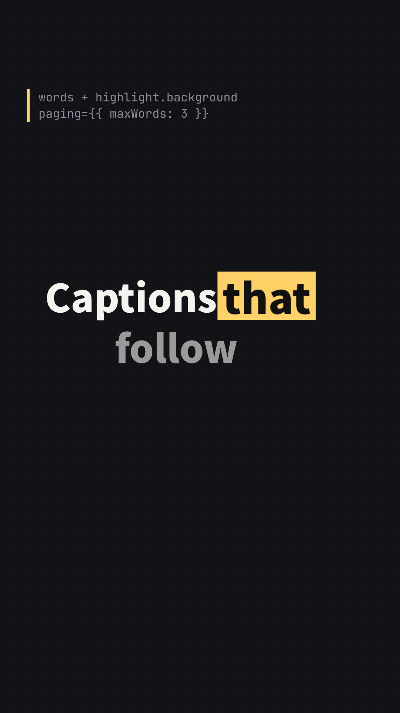

# Word captions

Captions lit word by word, the way vertical short videos set them: the word
being spoken changes color, grows, or sits on a band, and a long line is
shown a page at a time. Fifteen seconds at 30 fps, 1080 × 1920, in three
five-second takes on `<CaptionTrack>` from `@celesta/components`.



| Time | Take | Props |
| --- | --- | --- |
| 0–5 s | English with a timing per word, as a speech-to-text transcript gives them. A band slides to the word being spoken, which grows a little; the words to come are dimmed, three words a page. | `words`, `highlight.background`, `highlight.scale`, `highlight.upcomingColor`, `paging.maxWords` |
| 5–10 s | Japanese with a timing per morpheme, as a voice engine gives them. `wordUnit="phrase"` joins them into phrases (文節), so `話し` `て` `いる` light as `話している`; a page ends when the next phrase would take a third line. | `words`, `wordUnit="phrase"`, `highlight.scale`, `maxLines` |
| 10–15 s | Japanese with no timings at all: the cue's frames are shared out among its phrases by length, a line a page. | `wordUnit="phrase"`, `highlight.background`, `highlight.spokenColor`, `maxLines={1}` |

The captions sit in the middle of the `'vertical-social'` safe area, clear
of the platform's buttons and caption bar. Punctuation that is not in
`words` (`、` `。` `,`) goes with the word before it, and a page also ends
after a word that ends a sentence.

The band and the growth are placed from per-glyph metrics, so they show in
the Celesta desktop app and the exporter; the browser renderer
(`@celesta/web`) changes only the colors.

- `film.tsx`: the composition. Open it with Celesta using **File → Open…**.
  The fonts come from Google Fonts, so the first export needs a network
  connection.
- `poster.jpg`: frame 25, with "that" lit on its band.

## Reproduce

From the repository root, with a source build:

```sh
node skills/celesta/scripts/inspect.mjs examples/word-captions/film.tsx --frames 25,170,330
target/release/celesta-exporter --json --react examples/word-captions/film.tsx examples/word-captions/word-captions.mp4
```
